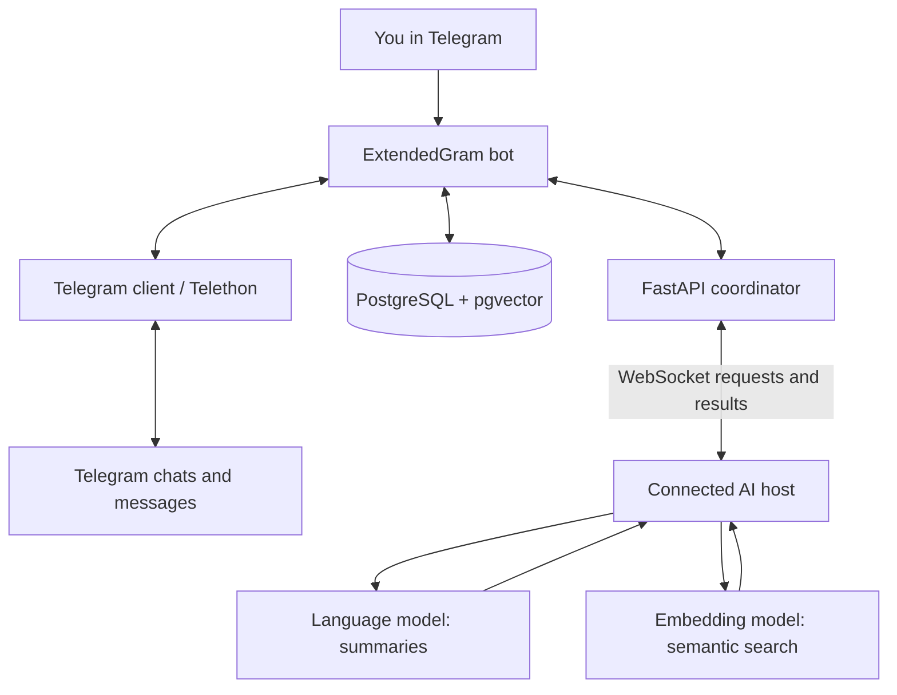

# ExtendedGram

**Catch up on Telegram conversations, find forgotten messages, and stay organized with AI.**

[Open the bot in Telegram](https://t.me/soprano_jr_bot)

ExtendedGram is a Telegram assistant for people who have too many messages to read and too much information scattered across chats. It can summarize conversations, search for messages by meaning, and help you focus on the chats that matter to you—all through a Telegram bot.

It works with private chats, groups, channels, and individual forum topics. You decide which conversations the assistant is allowed to process. **Your Telegram session is encrypted before it is stored; encryption is mandatory.**

> **Project status:** ExtendedGram is under active development. Availability and the exact menus may change.

## What can you do with ExtendedGram?

### 📝 Catch up without scrolling

If a group has hundreds of unread messages, you can ask ExtendedGram to summarize the conversation instead of reading everything one by one.

The assistant groups messages into related topics and focuses on useful details such as **decisions, deadlines, questions, plans, and conclusions**, rather than repeating the entire chat.

**For example:** After missing a day of messages in a university group, you could get a summary of upcoming assignments, changes to a meeting time, and questions that still need answers.

You can adjust how much conversation history the assistant takes into account. If you prefer, you can also have messages marked as read after a summary.

### 🔎 Find messages by meaning

Telegram's ordinary search is useful when you remember a word or phrase. ExtendedGram is designed for the times when you remember **what was discussed**, but not **how it was phrased**.

For example, search for:

> What did we agree on for the trip next weekend?

ExtendedGram can look for related conversations about dates, transport, or accommodation—even if your exact question never appeared in the chat. It also retrieves nearby messages so you can see the surrounding context.

Search quality depends on the available message history and the AI model; relevant results are not guaranteed every time.

### 💬 Keep different conversations separate

ExtendedGram supports:

- Private one-to-one chats
- Groups and supergroups
- Channels
- Individual forum topics inside groups

Forum topics are handled separately so that, for example, a group's *Homework* topic does not get mixed up with its *Announcements* topic.

### ⚙️ Control how it behaves

You can personalize the assistant through its settings:

- **Allowed conversations:** Let it process all available chats or only chats you select.
- **History size:** Choose how much message history is considered.
- **Read status:** Decide whether processed messages should be marked as read automatically.
- **Preloading:** Configure preparation of message history for later searches.
- **Process new images:** Choose whether the bot should generate descriptions for
  images without a saved description. Saved descriptions are reused either way.

This lets you use ExtendedGram for a single busy group or across multiple conversations.

## Getting started

You don't need to understand databases, AI models, or servers to use the bot.

1. **Open [the ExtendedGram bot](https://t.me/soprano_jr_bot).**
2. **Send `/start`.** Follow the instructions shown by the bot.
3. **Connect your Telegram account.** Enter your phone number and Telegram verification code. If two-step verification is enabled, follow the additional password prompt.
4. **If you chose to be a host**, follow [Host configuration](#host-configuration) below to connect your computer.
5. **Choose which chats can be processed.** Review your allowed-chat settings before using search or summaries.
6. **Use the menu.** Choose **Summarize**, **Search**, or **Settings** depending on what you need.

You can use the bot without your own connected host, but AI operations need a
compatible connected host, either your own or one shared by a group.

Bot sessions expire after 30 minutes without button presses or messages when
the user's own host is disconnected. Disconnecting that host starts a fresh
30-minute period; a connected own host keeps the session open. Expiry closes
the Telegram client and asks for the bot password, while retaining stored data.
Background preloading does not extend the period. A foreground search or summary
can finish before the idle period starts.

The bot removes completed selection screens and replaces old menus when opening
a new screen. Download and model progress messages are removed after completion
or failure. Login and host-connection confirmations, search answers, and summaries
remain in the chat. Only explicitly temporary form prompts are removed on the next
screen. Processing errors are displayed
with the menu buttons instead of adding a separate error and menu message.

In **Settings → Groups**, members can see a group's required embedding model.
The group creator sets it when creating the group and can change it later.
Type `default` to use the model supplied by the bot operator. Your own host
takes priority; otherwise the bot picks
an eligible shared host from your groups. Search uses a single model and the
configured history period for both indexing and finding matches.

After choosing search chats, enter your question. Then choose **Use history size**
to start immediately, or **Set date interval** and enter, for example,
`01.11.2026 - 25.11.2026`. Sending the valid interval starts the saved question
automatically. Both dates are included, using UTC calendar days.
The range applies to new indexing, saved search matches, and surrounding context.
Choose **Use history size** to return to the configured number of days.
The image-processing preference is saved per account. Enabling it later
processes skipped images when their messages are scanned again.

**Example workflow:** Open the bot after a busy day → select your class group → request a summary → search for “when is the project due?” if you need a specific detail.

> **Important:** Connecting an account creates a Telegram user session, which can access Telegram on your behalf. Only log in through an instance whose operator you trust. Never send login codes or passwords to people in direct messages.

## Host configuration

An AI host runs on your computer and connects to an existing bot instance over
HTTPS/WSS. Ask the bot operator for its public server URL. You need Python 3.14
or Docker and a running OpenAI-compatible model server.

Download only the host folder:

```bash
git clone --filter=blob:none --sparse https://github.com/tonda228/extendedgram.git
cd extendedgram
git sparse-checkout set host
```

Run all following commands from the repository root, which contains `host/`.
Copy `host/.env.example` to `host/.env` and fill in your settings:

```dotenv
COORDINATOR_URL=https://YOUR_SERVER_ADDRESS
OPEN_AI_URL=http://127.0.0.1:1234/v1
OPENAI_API_KEY=replace-with-your-model-server-key
COMPLETIONS_MODEL=your-completions-model
EMBEDDING_MODEL=your-embedding-model
```

- `COORDINATOR_URL`: the HTTPS address supplied by the bot operator. Both pairing
  and WebSocket connections use it; there is no default server address.
- `OPEN_AI_URL`: your model server's API URL, including `/v1`.
- `OPENAI_API_KEY`: the key required by that model server. Use `local` only if
  the endpoint allows unauthenticated requests; the client requires a nonempty value.
- `COMPLETIONS_MODEL`: the model name used for summaries, search answers, and
  image descriptions. Enable image processing only with a model that supports it.
- `EMBEDDING_MODEL`: the exact name of an available model producing
  1,024-dimensional embeddings.

For several embedding models, add a comma-separated list:

```dotenv
EMBEDDING_MODELS=model-a,model-b
```

This overrides `EMBEDDING_MODEL`. The first model is used for your own requests;
shared group requests use the group's required model. Every advertised model
must be available and produce 1,024-dimensional embeddings. A shared host is
eligible only when it offers the group's exact model name.

### Run with Python

In your Python environment, install the host dependencies and start it:

```bash
python -m pip install -r host/requirements.txt
python -m host.main
```

### Run with Docker

If your model server runs directly on a Windows PC and the host runs in Docker
Desktop, use its actual port with this address in `host/.env`:

```dotenv
OPEN_AI_URL=http://host.docker.internal:1234/v1
```

Start the host interactively:

```bash
docker compose -f host/compose.yaml run --build --rm host
```

No incoming ports need to be opened on your computer for the host connection.

### Pair, stop, and update

Open **Settings → Pair host** in Telegram. Enter your user ID, pairing code,
and bot password in the host terminal. Pairing codes expire after 10 minutes;
request another one in Settings if needed.

On later launches, choose `n` to reuse saved credentials or `y` to pair another
account or replace a pairing. Press Ctrl+C to stop the host. Saved credentials
remain in `host/auth.json` for Python runs or a named volume for Docker runs.
Keep `.env` and `auth.json` private; both are ignored by Git.

To update, run `git pull` from the repository root. Reinstall the host
dependencies and restart it, or rerun the Docker command with `--build`.

See the [detailed host guide](host/README.md) for virtual environment setup and
platform-specific commands.

## 🔐 Privacy and security

ExtendedGram needs to read messages from conversations you authorize. It also needs to remember your Telegram login so that you aren't asked to sign in every time you search or request a summary.

### Why is a Telegram session stored?

A **session** is a digital login credential. Once you've connected your account, it lets the application talk to Telegram for you. Without a stored session, you'd need to complete the login process again and again.

Because a session is sensitive, **ExtendedGram encrypts Telegram sessions before storing them. This protection is mandatory, not an optional setting.**

### What protects the stored session?

- **Encryption:** ExtendedGram uses **AES-256-GCM** to turn the stored session into unreadable encrypted data. This also helps detect unauthorized changes to that data.
- **Password-derived protection:** It uses **PBKDF2-HMAC-SHA256**, with **600,000 iterations** and a random salt, to derive an encryption key. This makes password guessing more expensive.
- **Fresh random values:** Encryption uses randomized values so the same original text does not always produce identical encrypted output.
- **Encoding for storage:** The encrypted result is converted to a text-friendly representation using Base64. **Encoding is not encryption**; AES-GCM is what protects the contents.

**What does this mean in practice?** Someone who obtains only the encrypted session from the database should not be able to use it without the information required to decrypt it. This is an important safeguard, but it isn't a guarantee against every kind of account compromise.

### Does this mean nobody else can access my messages?

No. ExtendedGram must use the session while it is running in order to read the conversations you permit. The application operator's security practices are important, even when stored sessions are encrypted.

You can **limit which chats are processed**. This is different from limiting what access a Telegram user session technically has, so you should still use only instances you trust.

### Where does AI processing happen?

ExtendedGram can use AI models running on a local computer or a connected/shared computing host. The messages needed for a request may be sent to the host performing the processing.

If you join a group that shares computing resources, **use a host you trust**. Local AI processing can reduce reliance on external AI services, but does not by itself guarantee that messages are private from a host operator. The application may also store messages and their AI-generated representations to enable later searches.

### A few safety tips

- Use only an ExtendedGram instance operated by someone you trust.
- Select only the conversations you want the assistant to process.
- Think carefully before using shared AI hosts for sensitive conversations.
- Treat any unexpected request for Telegram credentials as suspicious.

## How ExtendedGram works

*This section is for curious users and developers. You can use the bot without understanding it.*

### Architecture diagram



The diagram is simplified: it shows the key components and how they cooperate, not every internal request or database operation.

### When you ask for a summary

1. The Telegram client retrieves messages from the selected conversation.
2. ExtendedGram prepares the conversation and organizes it for AI processing.
3. An AI language model identifies related topics and produces a compact summary.
4. The bot sends the summary back to you in Telegram.

### When you search for something

1. ExtendedGram converts your question into a numerical representation of its meaning (an **embedding**).
2. It compares that representation with stored message embeddings to find related messages.
3. It retrieves surrounding messages when available, so a result isn't shown without context.
4. It returns the relevant messages through the bot.

### Why are there separate AI hosts?

Running AI models can require a powerful computer. ExtendedGram separates the bot from that heavy processing, so a connected **host** can handle AI requests and return the results.

A FastAPI backend coordinates work with hosts over WebSockets. Depending on the setup, a user can use their own host or participate in a group where computing resources are shared. **Sharing compute also means trusting the host with the content sent for processing.**

### Technology behind the project

| Purpose | Technology |
| --- | --- |
| Telegram account access | Telethon |
| Bot interface | python-telegram-bot |
| Application language | Python |
| Coordination and communication | FastAPI and WebSockets |
| Message storage | PostgreSQL |
| Meaning-based search | pgvector and embedding models |
| Summarization | Large language models through OpenAI-compatible APIs |
| Containerization | Docker |

## Project status

**Under active development.** ExtendedGram is a personal software engineering project exploring practical uses of language models, semantic search, Telegram automation, and distributed AI processing. Features and user experience may change.

## Author

Created by [Anton Chebotarov](https://github.com/tonda228).

## Running tests

Install the development dependencies and run pytest from the project root:

```bash
python -m pip install -r requirements-dev.txt
python -m pytest
```

The tests cover encryption, Pydantic models, bot menus and authentication, host search and summaries, server host selection and request helpers, and preloading. Fake services provide responses without a running database, Telegram credentials, or an AI host.

## Processing large requests

The AI host sends all supplied messages in one model request. If the model
reports that its context is too small or truncates its answer, the host splits
the input and retries the smaller parts. A single oversized message fails
without repeatedly resending it. Fixed message-count and character limits,
including the old `LLM_BATCH_*` settings, have been removed.

Missing message embeddings are requested together for each chat. If the
embedding API rejects the request size, the host splits the input while keeping
the vectors in message order. The bot displays preparation and model progress,
with a combining stage when needed.
